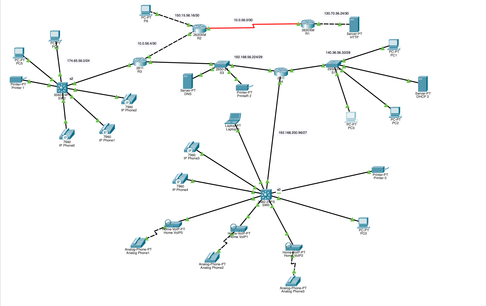

# Red multisede con telefonía IP · Cisco Packet Tracer

Red de 4 routers con enrutamiento OSPF, servicios DNS, HTTP y DHCP, y telefonía IP en dos sedes que se llaman entre sí a través de la red.

Proyecto en pareja para la materia Redes de Comunicación de Datos, Ingeniería Informática, Universidad Católica Andrés Bello (UCAB). Enero 2026.



## Qué se configuró

- **Direccionamiento con VLSM:** cada red usa la máscara que corresponde a su tamaño, desde /24 hasta /30 en los enlaces entre routers.
- **Enrutamiento dinámico OSPF** (proceso 1, área 0) en los 4 routers, con enlaces seriales y FastEthernet.
- **Servicios de red:** servidor DNS, servidor web HTTP y DHCP.
- **Telefonía IP con Cisco CME** (`telephony-service`) en R3 y R4. Cada router es la central de su sede.
- **DHCP en el router para los teléfonos**, con la opción 150 para que se registren en la central.
- **Llamadas entre sedes** con `dial-peer voice voip`, que envían las extensiones de la otra sede a través de la red OSPF.
- **Teléfonos analógicos** conectados con adaptadores VoIP (ATA).

## Esquema de direccionamiento

### Routers

| Equipo | Interfaz | Dirección IP | Máscara |
| --- | --- | --- | --- |
| R1 | Fa0/0 | 130.70.56.25 | 255.255.255.252 |
| R1 | Se0/0 | 10.0.56.1 | 255.255.255.252 |
| R2 | Se0/0 | 10.0.56.2 | 255.255.255.252 |
| R2 | Fa0/0 | 10.0.56.5 | 255.255.255.252 |
| R2 | Fa1/0 | 150.15.56.17 | 255.255.255.252 |
| R3 | Fa1/1 | 10.0.56.6 | 255.255.255.252 |
| R3 | Fa1/0 | 192.168.56.225 | 255.255.255.248 |
| R3 | Fa0/0 | 174.65.56.1 | 255.255.255.0 |
| R4 | Fa1/1 | 140.36.56.33 | 255.255.255.240 |
| R4 | Fa1/0 | 192.168.200.97 | 255.255.255.224 |
| R4 | Fa0/0 | 192.168.56.226 | 255.255.255.248 |

### Hosts

| Equipo | Switch | Dirección IP | Máscara | Gateway |
| --- | --- | --- | --- | --- |
| PC1 | SW1 | 140.36.56.35 | 255.255.255.240 | 140.36.56.33 |
| PC2 | SW1 | 140.36.56.36 | 255.255.255.240 | 140.36.56.33 |
| PC3 | SW1 | 140.36.56.37 | 255.255.255.240 | 140.36.56.33 |
| Laptop 0 | SW0 | 192.168.200.98 | 255.255.255.224 | 192.168.200.97 |
| Printer 0 | SW0 | 192.168.200.99 | 255.255.255.224 | 192.168.200.97 |
| PC0 | SW0 | 192.168.200.100 | 255.255.255.224 | 192.168.200.97 |
| PC4 | SW2 | 174.65.56.3 | 255.255.255.0 | 174.65.56.1 |
| PC5 | SW2 | 174.65.56.4 | 255.255.255.0 | 174.65.56.1 |
| Printer 1 | SW2 | 174.65.56.5 | 255.255.255.0 | 174.65.56.1 |
| Printer 2 | SW3 | 192.168.56.228 | 255.255.255.248 | 192.168.56.226 |
| PC6 | R2 | 150.15.56.18 | 255.255.255.252 | 150.15.56.17 |

### Servidores

| Servidor | Dirección IP | Máscara | Gateway |
| --- | --- | --- | --- |
| DNS | 192.168.56.227 | 255.255.255.248 | 192.168.56.226 |
| HTTP | 130.70.56.26 | 255.255.255.252 | 130.70.56.25 |
| DHCP 2 | 140.36.56.34 | 255.255.255.240 | 140.36.56.33 |

## Redes publicadas por OSPF

| Router | Red | Wildcard |
| --- | --- | --- |
| R1 | 130.70.56.24 | 0.0.0.3 |
| R1 | 10.0.56.0 | 0.0.0.3 |
| R2 | 10.0.56.0 | 0.0.0.3 |
| R2 | 10.0.56.4 | 0.0.0.3 |
| R2 | 150.15.56.16 | 0.0.0.3 |
| R3 | 10.0.56.4 | 0.0.0.3 |
| R3 | 174.65.56.0 | 0.0.0.255 |
| R3 | 192.168.56.224 | 0.0.0.7 |
| R4 | 192.168.56.224 | 0.0.0.7 |
| R4 | 140.36.56.32 | 0.0.0.15 |
| R4 | 192.168.200.96 | 0.0.0.31 |

## Telefonía IP

| Sede | Router | Red de voz | Extensiones |
| --- | --- | --- | --- |
| Sede A (SW0) | R4 | 192.168.200.96/27 | 53001 a 53005: 2 teléfonos IP 7960 y 3 analógicos con ATA |
| Sede B (SW2) | R3 | 174.65.56.0/24 | 37001 a 37003: 3 teléfonos IP 7960 |

Configuración de voz en R4 (Sede A):

```
ip dhcp pool VOZ-SEDE-A
 network 192.168.200.96 255.255.255.224
 default-router 192.168.200.97
 option 150 ip 192.168.200.97
 dns-server 192.168.56.227
!
telephony-service
 max-ephones 10
 max-dn 10
 ip source-address 192.168.200.97 port 2000
 auto assign 1 to 5
!
dial-peer voice 37 voip
 destination-pattern 37...
 session target ipv4:174.65.56.1
```

El `dial-peer` hace que cualquier número de 5 dígitos que empiece por 37 (Sede B) se envíe a R3 a través de la red OSPF.

## Cómo abrirlo

1. Descarga el archivo `.pkt` de este repositorio.
2. Ábrelo con Cisco Packet Tracer.
3. Para probar la telefonía, abre un teléfono de la Sede B y marca 53001.

## Nota sobre el direccionamiento

Algunas LAN usan rangos públicos (por ejemplo 140.36.x.x y 174.65.x.x) porque así lo pedía el ejercicio. En una red real, las LAN internas usarían rangos privados (10.0.0.0/8, 172.16.0.0/12 o 192.168.0.0/16) y saldrían a internet con NAT.
